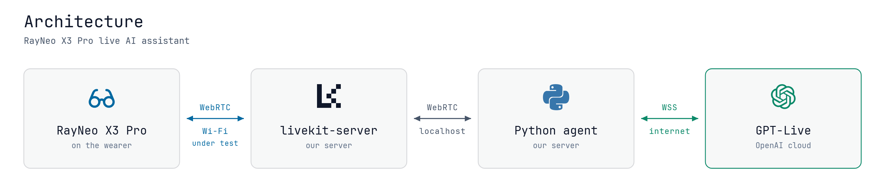
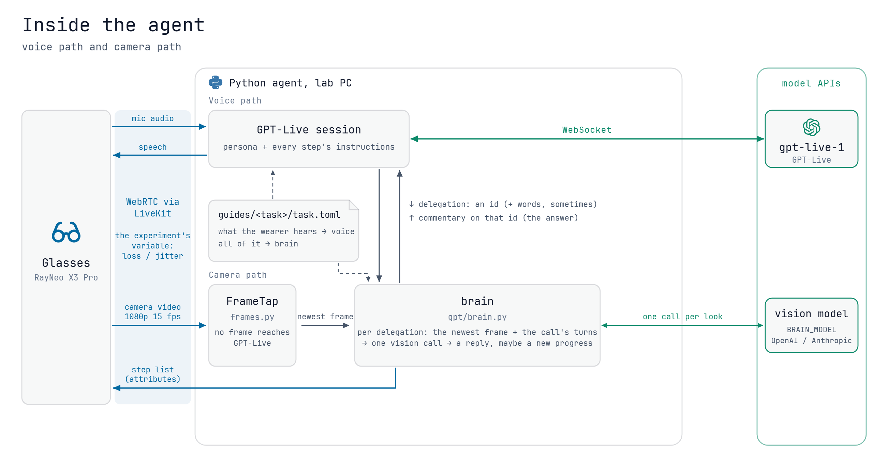

# RayNeo X3 Pro live AI assistant

A voice assistant for RayNeo X3 Pro AR glasses that guides the wearer through a LEGO build,
built on LiveKit and OpenAI's GPT-Live. GPT-Live talks; when an answer needs eyes it hands
the question to the agent, which looks at the newest camera frame with a vision model and
keeps track of the step. The project is a test bed for
how the network between the glasses and the server changes that experience. A Gemini Live
path is kept but not in use.

## Architecture

<picture>
  <source media="(prefers-color-scheme: dark)" srcset="docs/architecture-dark.png">
  
</picture>

<sub>Sources: `docs/architecture-*.svg`; `python docs/make_diagram.py` regenerates them
and the PNGs (`make_agent_diagram.py` for the figure below).</sub>

The two halves meet in a LiveKit room. The glasses publish microphone and camera tracks
into it; the agent joins the same room, streams the audio to GPT-Live over a WebSocket,
keeps the camera frames for the vision model, and publishes GPT-Live's speech back as its own
audio track. The glasses hold no model credentials. The Wi-Fi hop between the glasses and
the server is the experiment's only variable: loss and jitter are injected there.

Three processes in one compose project, host networking (WebRTC needs the server's UDP
ports reachable at the address it advertises):

- **livekit-server** verifies join tokens and forwards media.
- **api**: the glasses `POST /getToken` with a credential; `auth.py` turns it into a user
  id or a 401, `server.py` signs a ten-minute JWT with that identity and a `room_config`
  naming the agent, with the build the glasses picked (`?task=`) as the agent's dispatch
  metadata. `GET /tasks` lists the builds on offer. `AUTH_MODE`: `dev` accepts everyone
  (private LAN), `static` wants one shared bearer token, `jwt` verifies a token from an
  account system.
- **agent** registers under `AGENT_NAME`, joins only rooms whose token names it, and alone
  holds the model API keys. `AGENT_BACKEND=openai` runs the system below (`agent/src/gpt/`);
  `gemini` runs the old Gemini Live path (`agent/src/gemini/`). Model ids come from `.env`.

### Inside the agent

GPT-Live hears the wearer and speaks; it knows every step's wording but never sees a frame.
What needs eyes it hands over to the agent's brain, which answers from the newest frame and
holds the step. One task file feeds both.

<picture>
  <source media="(prefers-color-scheme: dark)" srcset="docs/agent-dark.png">
  
</picture>

1. **Voice.** `gpt-live-1` is audio only and full duplex, and owns turn-taking and barge-in
   (no VAD on the session). Its instructions are the persona and every step's brick and where
   it goes (`gpt/prompts.py`); it gives a step in two parts: which brick to find, then, once the
   wearer has it, where it goes. What needs no eyes (the next step, an earlier one, what a brick looks
   like) it answers itself. Whatever depends on what is in front of the wearer ("is this
   right?", "where does it go?", "what is this?") it delegates; a goodbye it answers itself and
   the wearer hangs up on the glasses. It opens the call by naming the build. Client
   delegation: the plugin hands the agent an id (and the wearer's words when they are not in
   the history yet, often not), no backend model runs.
2. **Brain** (`gpt/brain.py`), one stateless vision call per delegation, to OpenAI or
   Anthropic (`BRAIN_PROVIDER`, `BRAIN_MODEL`, `BRAIN_EFFORT`), built like LiveKit's
   client-delegation example. Instructions: the role (the eyes; it never speaks to the wearer,
   the voice says its reply), every step's brick and where it goes (a step is right when the
   photo shows that brick there), how to reply; the same on every call, so the prompt cache
   hits. One tool, `confirm_step_correct(step)`, its rules in its own description. Turns: the call's
   chat history, the wearer as user and the voice as assistant. The last turn: the camera
   frame's bottom square (the glasses look down at the table; the top of the portrait frame is
   wall) at `BRAIN_SIDE` (1080), the current step, the wearer's latest words.
   The reply, plain facts, goes back as commentary on that delegation id ("Camera: ..."), which
   the voice says in its own words. Only a confirm call moves the build: published to the
   glasses, told to the voice in the same commentary and as one line of thinking; no call,
   nothing moves (not done, not sure, or not asked). A newer delegation cancels an older one still running; a call over
   `BRAIN_TIMEOUT` (12 s) answers "the helper could not answer, say it again". Only the newest photo
   goes, and the brain's earlier replies are not sent back to it: what a look saw survives as
   what the voice said of it. Offline tests of models, image and prompt:
   `eval/brain/RESULTS.md`.
3. **Task file** (`guides/<task>/task.toml`; the 13 numbered five-brick tasks of
   `tasks/sheet.html`, picked on the glasses): per step a name for the list on the glasses, the
   brick, where it goes against the bricks before it (step 1 only roughly on the plate), and the
   brick's cells as drawn, which go to no model. One vocabulary throughout, also in both prompts: the
   plate as a picture lying in front of the wearer, up = far edge, down = near edge, a brick
   vertical or horizontal.

The brain looks only when asked; nothing announces a finished step on its own yet. The
camera loop of `lego-harness-v1` (`gate.py`, `judge_vlm.py`, `judge_cv.py`, `progress.py`,
`gpt/watch.py`: a gate, a four-way verdict per frame, a state machine, notes pushed to the
voice) is kept but not run; `eval/` imports the gate, judges and state machine and replays a
recorded run through them (`eval/RESULTS.md`).

## Layout

```
backend/
  docker-compose.yml    livekit-server + api + agent, host networking
  .env.example          copy to .env and fill in; one file for all three
  api/src/server.py     POST /getToken (LiveKit's standard token endpoint), GET /tasks (the build picker's list)
  api/src/auth.py       AUTH_MODE = dev | static | jwt
  agent/src/agent.py    entrypoint: AGENT_BACKEND=gemini|openai picks the implementation
  agent/src/guide.py    build guide loader and the state of one run (shared)
  agent/src/frames.py   FrameTap: keeps camera frames for the brain
  agent/src/runlog.py   one record per call under RUN_DIR (backend/runs)
  agent/src/gpt/        agent, config, prompts (voice persona, brain instructions), brain (delegation -> frame -> answer)
  agent/src/gate.py, judge_vlm.py, judge_cv.py, progress.py, gpt/watch.py
                        the lego-harness-v1 camera loop, not run; eval/ uses the first four
  agent/src/gemini/     the Gemini Live path (not in use)
  agent/src/render.py   reference-model video stream (used by guides with a model.glb; the truck has none)
  agent/guides/         build guides: the numbered tasks the glasses pick from; BUILD_GUIDE when none is picked
android/                Kotlin + Compose app for the glasses (build picker, call screen)
tasks/                  the five-brick task sheet (sheet.html) and the bricks it uses (bricks.jpg)
deploy/
  setup.sh              first-time setup on a Linux host: key pair, livekit.yaml, .env
  livekit.lab.yaml      livekit-server config for a private LAN
  glasses.ps1           launch/stop the app on the glasses over adb
  watch.py              coloured live view of the agent log
  report.py             a call's record as one HTML page
  record.ps1            record a build with the glasses' stock camera app over adb
eval/                   offline evaluation on recorded runs: brain/ (the brain's looks), judge / gate / replay of the old loop
```

## Running the backend

On a Linux host with Docker:

```shell
deploy/setup.sh lab                 # once: key pair, livekit.yaml and backend/.env
cd backend
GIT_COMMIT=$(git describe --always --dirty) docker compose up -d --build   # livekit-server :7880, api on API_PORT, agent
docker compose logs -f --no-log-prefix agent | python3 ../deploy/watch.py   # coloured conversation
docker compose down
```

`setup.sh` fills in the LiveKit keys; put `OPENAI_API_KEY` (and `ANTHROPIC_API_KEY` for an
Anthropic brain) and the model ids into
`backend/.env` (see `.env.example`). `LIVEKIT_URL` stays on loopback for the agent;
`LIVEKIT_PUBLIC_URL` (`ws://<lan-ip>:7880`) is what `/getToken` hands the glasses. It prints
the ufw rules the glasses need if ufw is active.

What the agent log shows: `experiment:` (every switch of the run), `step n/m start|done`,
`user:` / `assistant:` (both transcripts, printed when a turn ends), `live:` (the call's
timeline: the wearer and the voice going speaking / listening, and GPT-Live's own events:
`delegation.created`, the commentary or thinking it took in, errors), `delegation:` (what the
voice handed over, with the wearer's words), `brain:` per ask (the frame it took and how long
after the ask, when the request went out, when the reply came back with tokens: cached, written,
thinking, the tool call, the saved frame's file name, the reply; `brain: thinking:` /
`brain: commentary` what reached the voice), `voice:` (when the voice started saying the answer:
ms after the commentary and after the delegation), `camera:` (first frame, or none 10 s in) and
`link:` (the glasses joining and leaving, with the SFU's reason, and the SFU's quality score) and
`gpt-live:` (the voice session's start and close with the seconds billed; GPT-Live bills by the
session second).

Every call also leaves a record in `backend/runs/<UTC start>-<room>/` (`runlog.py`): `events.jsonl`
(the same story with every field: who speaks when, both transcripts, each hand-over, each look's
photo, whole input, reply, tool call, tokens and timings, step changes, link events), the photos
sent to the brain (`ask<n>-s<step>.jpg`), and both prompts as sent (`brain.txt` with `brain-tools.json`, `voice.txt`).
`python3 deploy/report.py backend/runs/<call>` writes `report.html` beside it: settings and commit,
steps done, brain and wait times, what went wrong, a timeline, and one card per hand-over. Build
with `GIT_COMMIT=$(git describe --always --dirty) docker compose up -d --build` so the record
names its commit. The container writes as root; delete records with
`docker run --rm -v "$PWD/runs:/r" backend-agent sh -c "rm -rf /r/2026*"`.

Without Docker, against `docker run --rm -it --network host livekit/livekit-server --dev`:

```shell
cd backend/api;   uv sync; uv run src/server.py
cd backend/agent; uv sync; uv run src/agent.py start
```

**Never set the root logger to `DEBUG`.** That enables the `websockets` client logger, which
prints outgoing headers including API keys. `--log-level debug` on the agent CLI is scoped
to LiveKit's loggers and is fine. If it happens, rotate the key.

## The glasses

```powershell
cd android
./gradlew :app:assembleDebug        # needs a JDK; Android Studio's jbr works
adb install -r app/build/outputs/apk/debug/app-debug.apk
.\deploy\glasses.ps1 -Ip 192.168.50.147   # launch, pointed at that backend (-Install builds first, -Stop kills it)
```

The debug variant is required: it carries the network security config that allows
cleartext `http://` and `ws://` to a LAN IP. The app stores the token endpoint and
credential, which `glasses.ps1` passes as intent extras. It opens on the build picker: the
numbered tasks from the api's `GET /tasks` (every `guides/<name>/task.toml` with a `number`).
On the temple touchpad a swipe moves the pick, a tap starts the call with it
(`/getToken?task=<name>`; the api puts it into the agent's dispatch metadata and the agent
loads that task, `BUILD_GUIDE` without a pick), and a double tap ends the call or leaves the
app. `glasses.ps1 -Task <name>` preselects one.

During a call the top line shows who has the floor. Below it the left half lists the
build's steps with the current one highlighted and kept in view (`BuildSteps.kt`); the right
half shows the conversation, newest at the bottom, the wearer's lines in green
(`Captions.kt`). Both halves scroll by themselves. The wearer's lines are the model's
transcript of what it heard, so a word the network dropped is missing there too. The mic is
switched on once the agent reports that it is listening ("Ready"). The call screen leaves by
itself when the room ends.

USB carries adb, not media: `adb reverse` forwards TCP only and libwebrtc binds to the
Wi-Fi interface, so the glasses and the server must share an IP network.

### Two screens

The X3 Pro has a 640x480 panel per eye. Android reports one 1280x480 display at density
160; the left 640 px go to the left eye, the right 640 px to the right. A phone layout is
cut in half, so every screen draws its content twice through `ui/Eyes.kt`. Rules:

- State lives above `Eyes`; a `remember` inside the content runs once per eye and drifts.
- `Eyes` keeps a 24 dp black margin; the optics distort at the panel edges. Do not use
  window insets at the root, they span all 1280 px and break the mirror symmetry.
- The display is additive: black emits nothing, so the background is black and there is no
  light theme.
- Check layouts with `adb shell uiautomator dump`, not `screencap`; the capture is
  post-correction and misreports positions.

### Camera

The sensor is mounted sideways, so frames reach the agent as 1080x1920 portrait. Focus is
fixed. The app publishes one layer at 1920x1080, 15 fps, H264 on the hardware encoder,
4 Mbps (`VoiceAssistantViewModel.kt`), through libwebrtc's `HardwareVideoEncoderFactory`
directly: the SDK's simulcast wrapper crop-scales every frame of this sensor. VP8 is software
on this SoC and stays blurry. `VideoStatsLog.kt` logs encoder resolution, fps and bitrate
every 5 s under `rayneo-video`.

## The Gemini path (not in use)

`AGENT_BACKEND=gemini` runs one Gemini Live model (`GEMINI_MODEL`) that hears, sees the
camera and judges the bricks itself through tools (`get_step`, `look`, `step_done`, ...), with
camera frames sent only while the wearer speaks or the model calls `look` (`sampler.py`).
It is kept as it was; the knobs are in `.env.example` and `agent/src/gemini/`.
`agent/src/inspect_frame.py` re-asks a saved frame at higher media resolutions.

## The lab PC

Ubuntu on the glasses' network, reached over ssh. It runs the recipe above:
`docker compose up -d --build` while testing, `docker compose down` after. The machine has
other jobs, so nothing is installed as a service. `AGENT_MP_CONTEXT=spawn` in `.env` is only
for a host whose CPU lacks AVX2; see the note in `agent.py`.

## When it breaks

A bad API key ends the session at once and the wearer hears silence. The banner turns red:
"Agent left" if an agent was in the room and went, "No agent" if none arrived within 20 s;
both say to double tap out. A connection the SDK is still retrying shows "Reconnecting"; that
banner reads the SDK engine's own state (`EngineState.kt`), because the public room state
stays "connected" through a soft reconnect, which is what a Wi-Fi drop triggers first.

The glasses switch Wi-Fi off by themselves a minute after they decide they have been taken
off (the system's deep-suspend policy; the wear sensor also misfires mid-session).
`glasses.ps1` turns that policy off at launch (`deep_suspend_disabled_persist 1`, survives
reboots); `glasses.ps1 -RestoreSleep` puts it back. If the banner sticks at "Reconnecting",
check `adb shell settings get global wifi_on`; `adb shell svc wifi enable` brings it back.

## Reference

- [GPT-Live plugin](https://docs.livekit.io/agents/models/realtime/plugins/gpt-live/)
- [GPT-Live guide](https://developers.openai.com/api/docs/guides/live)
- [Agent dispatch](https://docs.livekit.io/agents/server/agent-dispatch/)
- [Token endpoint spec](https://docs.livekit.io/frontends/build/authentication/endpoint/)
- [Running LiveKit locally](https://docs.livekit.io/transport/self-hosting/local/)
- [RayNeo dev docs](https://rayneo-en.gitbook.io/rayneo-devdoc/x-series/android-sdk)
- [agent-starter-android](https://github.com/livekit-examples/agent-starter-android), the
  app's origin (MIT, `android/LICENSE`)
- [Earlier prototype](https://github.com/Lambozhuang/rayneo-x3-pro-gemini-live), glasses
  straight to Gemini Live without LiveKit
