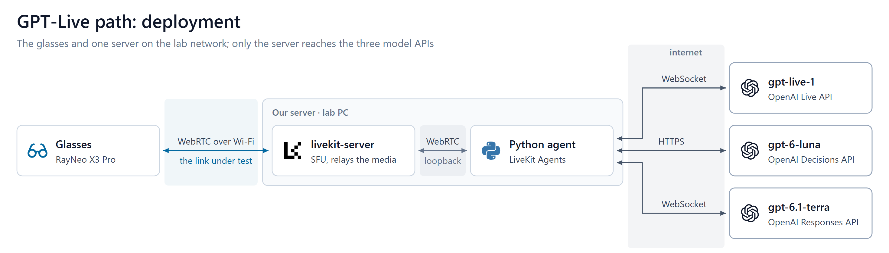
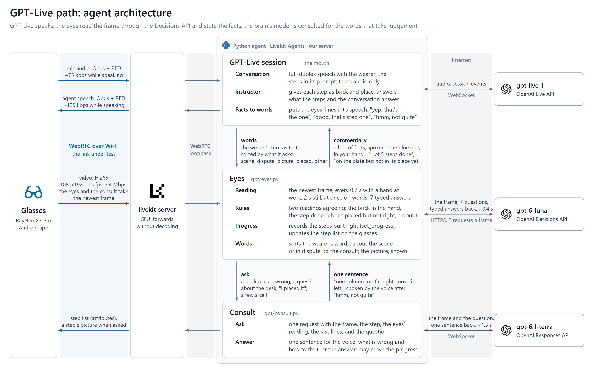

# RayNeo X3 Pro live AI assistant

A voice assistant on RayNeo X3 Pro AR glasses, on LiveKit: GPT-Live or OpenAI Realtime guides the wearer through a LEGO build, and Gemini Live answers whatever the wearer asks about what the camera shows.

## Overview

The project is a test bed: how does the network between the glasses and the server change a voice-and-vision assistant?

The LEGO build is the workload of the GPT and Realtime paths. The wearer picks one of 13 five-brick builds on the glasses and talks it through with the assistant. The assistant sees through the glasses' camera, says which brick to find and where it goes, checks each brick placed and keeps the step list on the glasses current.

The agent has three architectures: GPT-Live with a separate vision model, which runs the LEGO build; OpenAI Realtime alone, which sees the camera itself and runs the LEGO build, as a proof of concept; and Gemini Live alone, which runs no task: it is a general voice assistant that sees through the camera. The Gemini path runs no LEGO build: at the 280 tokens the Live API gives a frame it cannot count studs.

`docs/TASK.md` has the experiment: the task it is based on (ITU-T P.1321's block building), the choices made for ours, what is measured, and the papers behind them. `docs/TODO.md` is the open list.

## Architecture

There are two machines: the glasses, and a server on the same Wi-Fi network. The glasses talk only to the server; only the server talks to the model APIs (OpenAI, Anthropic, Google).

The glasses run the app in `android/`: it sends the mic and camera to the server, plays the assistant's speech and shows the steps, what the camera sees (the bottom square of the frame, which is what the vision model gets) and, when the wearer asks for one, a picture the agent sends, under the assistant's words. It holds no model keys.

The server runs three programs:

- **livekit-server**, LiveKit's media server: the glasses and the agent join the same room on it; it checks their join tokens and passes audio and video between them.
- **api** (`backend/api/`): lists the builds, and gives the glasses their join token with the build they picked and, in a lab run, the console's run.
- **agent** (`backend/agent/`): joins the room as the assistant, with that build loaded on the GPT and Realtime paths, and holds the model keys. It runs one of the three architectures below, picked by `AGENT_BACKEND`.

A call starts with the glasses asking the api for the builds; the wearer picks one or the lab console names one, the glasses get a join token for it and join the room, and the agent joins too. It ends when the wearer ends it on the glasses or the console ends it.

The lab console is QoE Lab, the app that shapes the lab network and runs the experiment's session; its contract for devices is `docs/developer-guide.md` in the qoe-lab repository, Participant Contract. The glasses connect to it as the target device (`Lab.kt`): the console's `start_task` names a task by its number within the run's phase, and the glasses start the call with that build: the first three builds of the task sheet are the training tasks and the rest are the experiment's, so training task k is sheet number k and experiment task k is sheet number k + 3 (`Lab.TRAINING_TASKS`), and a subject never builds in the experiment what they practised on; its `end_task` or the wearer's double tap ends the call, and the glasses report the run to the console, when the console asked for a log, with how far the build got, from the step list the agent published, and with what they measured during the call (`CallLog.kt`): the link's statistics as WebRTC sees them on the glasses, when the agent's voice reached the decoder, when each picture arrived and was shown, and the call's own bounds, each event timed from the task's start; a task that cannot start is reported at once as failed with the reason, and a `start_task` during a task drops that task unreported and starts the new one, as the contract says. In lab mode the glasses show the participant one sentence per stage and nothing else (`Lab.stage`, `LabScreen.kt`): before the first task that the experimenter starts it, between tasks to take the build apart and answer the questionnaire, when something fails to tell the experimenter; the connection's own state goes to the log. A launch with `-Lab` opens on that screen, the double tap does nothing there or during a lab call, and a task ends by itself: when the brain records the last step as done and the voice has said so, the agent publishes `rayneo.call.over` (`gpt/agent.py`) and the glasses, once the agent's voice has been silent at their decoder for a second, hang up and report the run as ended by `finished`; the console's `end_task` and its time limit end the others. During a lab call the title line shows the time left of the console's limit. The run's identity and the console's address ride in the token request into the agent's dispatch metadata, and the agent reports the same run with the call's record, photos left out, when the call ends (`qoe.py`); a report the console does not take waits in the record's directory and the agent process sends it again. A call started from the glasses' own list carries no run, and neither side reports anything.

### GPT-Live and a vision model (`AGENT_BACKEND=openai`, `backend/agent/src/gpt/`)





A mouth, a pair of eyes and a specialist, one instructor to the wearer, as on a video call with a person who has the instructions and sees the table. GPT-Live (`gpt-live-1`) is the voice: it hears the wearer and speaks, both at once, and decides itself when to talk; it takes audio only, so it cannot see. The eyes (`gpt/eyes.py`) read the newest camera frame through OpenAI's Decisions API (`gpt-6-luna`, typed answers in about 0.3 s) every 0.7 to 2 s and tell the voice the facts in a line when something changed. The consult (`gpt/consult.py`) asks the brain's model (`gpt-6.1-terra`) for the words the eyes cannot produce, what is wrong with a misplaced brick and the answer to a question about the desk, one request with the frame, a few times a call. The design follows what the Decisions API can and cannot do (`eval/brain-decisions/`): it tells a right placement from a wrong one but not where a wrong one should move.

1. GPT-Live's prompt holds every step and follows OpenAI's Prompting GPT-Live template (persona, backchannel policy, interruption policy, delegation policy). It leads as an instructor does: it gives each step as its brick and its place together, answers by itself whatever the steps, the conversation or the eyes' lines already answer ("got it" gets "good", "which step am I on" the number), says "let me see" and nothing more when the answer takes eyes ("is this the right one", "done") and waits for the line without guessing, gives an acknowledgement ("okay", "yep") a backchannel at most, takes the wearer's word on a brick's colour, and keeps a turn to one short sentence, two when a step is done and the next one given. It is told not to generate `<|SpawnThinking|>`, the token GPT-Live hands over with; a hand-over it makes all the same is closed at once with the eyes' last line while fresh or "let me look". The persona was tested on `eval/voice-script/` before the glasses heard it (2026-11-04 evening).
2. The eyes send two Decisions requests together on each frame, four questions about the scene (is a hand on the plate, which brick is in the hand, how many steps are built right, is the picture blurry) and three about the current step's brick (is it on the plate, does it sit as the step says, where does it lie), the questions built from the task file. One request with all seven spread the confidences, and a word of the current step in the scene questions pulled the count down (`eval/agent-sim/`). A reading comes every `BRAIN_QUICK_EVERY` seconds while the scene is still, every 0.7 s while a hand is on the plate or a brick in the hand, at once when the wearer has spoken, and never twice on one frame; the image goes at `BRAIN_QUICK_DETAIL` (`low`, 512 px, 0.3 s). Every rule acts on two readings in a row that agree, with their mean confidence over a bar, since the confidence swings between near-identical frames. The lines: the current step's brick in the hand, once per step ("Camera: The blue one, in your hand."; the voice says "yep, that's the one"); the step done, when the count rises or the step's brick sits on the plate as the step says with no hand on it ("Progress: ..."; the voice says "good, that's step one" and gives the next); the step's brick on the plate but not as the step says, hand off, count unmoved ("Camera: the white one is on the plate but not in its place yet"; the voice says "hmm, not quite" and the consult's sentence follows); two bricks the model cannot tell apart in the hand, one of them the step's ("in your hand, the yellow one or the lime one, I can't tell which"; the colour question the camera cannot settle, asked rather than asserted); the picture blurry, once a minute; where the step's brick lies when nothing has been in the hand for a while after the step was given. Every reading lands on the record (`quick` events, with every probability).
3. The wearer's words are classified by the same API on the text alone (a question about the scene, a disagreement, a request for the picture, "I placed it", "I have it", a question about the steps, an acknowledgement; `words` events) and routed: a question about the scene or a disagreement goes to the consult with the frame; a request for the picture puts it on the glasses (`show` in `gpt/agent.py`, the attribute first and the PNG as a byte stream); "I placed it" gives the eyes 2.5 s to settle the step and otherwise goes to the consult too, so the wearer never waits in silence after it; everything else needs no eyes.
4. The consult is one request to the brain's model over `BRAIN_TRANSPORT` (`ws`, a persistent WebSocket to the Responses API, 1.3 s a request against 1.6 over `http`, `eval/brain-speed/`), at `BRAIN_EFFORT` (`none`) and `BRAIN_SERVICE_TIER`, with the frame at `BRAIN_WATCH_SIDE`, the task, the step, the eyes' latest reading, the last eight lines said and what is asked; it answers with `say`, one sentence as a watching instructor would put it, and may move the progress with `set_progress` when it finds the placement right after all or a step undone. No conversation is kept between consults; the eyes hold the state. A correction's sentence that does not come within 3.5 s is replaced by a line that has the voice say the place once more and offer the picture. What a consult costs is what a look cost before; a call now makes a handful instead of seventy.
5. The brain of the day before, one vision model watching every two seconds with a conversation of its own, is kept in `gpt/brain.py` for its model clients, which the consult uses, and for the replays of `eval/brain-thread-replay/` and `eval/brain-speed/`; the agent no longer runs it. Tried on 2026-11-04 and taken out the same day: a silent `tell` channel (GPT-Live spoke it), a gate that held lines while the voice spoke and a step that stood only at the look after (every held line came late and stale), asking the wearer for no pose at all (a person asks for the hand to move when it is in the way), and luna as the talking brain (fast, but it spoke at 20 of 30 looks and moved the progress nine times where the plate moved twice).
6. Until the pilot of 2026-11-03 GPT-Live also handed the wearer's words over (a "delegation") and the brain answered each hand-over with a look of its own. The pilot's participant felt those answers come sometimes fast, sometimes slow, so the look went and GPT-Live's prompt tells it not to hand over; the record counts the hand-overs it makes all the same (`delegation` events). The picture is never put up unasked, and goes when the progress moves or the wearer says they no longer need it.

The brain's conversation is a chat with tools as a model is used anywhere: a message per look with what was said since the look before (`User: ...`, `Assistant: ...`) and the photo, the vision model's reply with its tool calls as the provider returned it, and one result per tool call saying what carrying it out did (`Recorded: 3 of 5 steps done; ...`). Nothing is dropped or rewritten, except that a photo is taken out once the model has answered on it: what the model wrote of it is what it keeps, and the progress it knows is what its last `set_progress` result told it. The brain is a second party helping GPT-Live, as OpenAI's own backend prompt puts it, not GPT-Live itself: GPT-Live's lines are labelled in the message, never passed as the vision model's own turns. OpenAI's Responses API gets the conversation as input items with the reasoning passed back encrypted (`store=False`); Anthropic's Messages API gets it as messages with the thinking blocks passed back. Every look's text block ends in an explicit prompt cache breakpoint, the request runs in explicit cache mode and the photo goes last as a user item of its own: on gpt-5.6 and later the API writes a cache entry only at a breakpoint and matches a request only against entries, never against a prefix two requests merely share, so a request ending in a photo that the next request drops caches nothing of the conversation (`eval/brain-thread-replay/`). What a look pays for uncached is the look before's answer, the new lines and the photo, about 1500 tokens whatever the call's length.

<sub>`python docs/diagrams/make_gpt_live_overview.py` and `docs/diagrams/make_gpt_live_agent.py` regenerate the two figures.</sub>

### OpenAI Realtime (`AGENT_BACKEND=realtime`, `backend/agent/src/realtime/`)

One model, OpenAI Realtime (`REALTIME_MODEL`, `gpt-realtime-2.1`), hears, sees, speaks and keeps the build's progress. It is a proof of concept, there to find out how well the model alone runs the LEGO build. Its prompt (`realtime/prompts.py`) holds every step, and its one tool, `set_progress`, moves the step list on the glasses (`realtime/tools.py`). It reasons at `REALTIME_REASONING_EFFORT` (minimal to xhigh, required). Turn detection and input transcription are the plugin's defaults; the voice is marin.

1. Camera frames go into the model's conversation as image messages: one a second while the wearer speaks (`REALTIME_SPEAKING_FPS`), one every ~3 s otherwise (`REALTIME_SILENT_FPS`, 0.3), the rule of LiveKit's own video sampler. Each is the bottom square of the frame, the table in front of the wearer, scaled to `REALTIME_SIDE` px, 1080 by default (`realtime/sampler.py`, the crop in `src/frames.py`). Every frame stays in the model's context and is read again on every turn, so the rates set the cost.
2. The model answers the wearer from what it hears and the frames it has; when it judges that more or fewer steps are built right, it calls `set_progress`, and speaks its verdict after the call returns.

The API's turn detection decides when the wearer has finished, and sets the wearer's state that picks the frame rate. Each frame shown to the model is saved into the call record (see Logs), so a run can be judged from what the model saw.

### Gemini Live (`AGENT_BACKEND=gemini`, `backend/agent/src/gemini/`)

One model, Gemini Live (`GEMINI_MODEL`: `gemini-3.8-live`, or `gemini-3.8-live-extended-thinking` reasoning in the background at `GEMINI_THINKING_LEVEL`), hears, sees and speaks. It has no task and no tools: its prompt (`gemini/prompts.py`) is the one the glasses-only prototype (rayneo-x3-pro-gemini-live) sends, word for word, and pins the reply language to English. The session is set up as the prototype sets up its own, apart from the camera frames and the turn detection: the voice Kore, `MEDIA_RESOLUTION_LOW`, the API's own sliding window over the context, and no greeting, so the wearer speaks first. The agent ignores the build the wearer picked, so the glasses show no step list.

1. Camera frames go to the model inline with the audio, one a second (`GEMINI_VIDEO_FPS`, the most the Live API takes), each cropped to the middle square of the frame and scaled to `GEMINI_SIDE` x `GEMINI_SIDE` px, 768 by default as Google recommends (`gemini/sampler.py`, the crop in `src/frames.py`). The model spends `GEMINI_MEDIA_RESOLUTION` tokens on each: 70 at the API default and at LOW or MEDIUM, 280 at HIGH, the most the Live API allows; the lab runs LOW, as the prototype does. Every frame stays in the model's context until the sliding window drops it, so the rate and the resolution set the cost. The window runs at the API's own trigger and target, and is configured because Google ends an audio-and-video session at two minutes without it.
2. The model answers the wearer from what it hears and the frames it has.

Gemini's own turn detection decides when the wearer has finished. Both sides are transcribed for the log in US English; the model always answers in English, whatever `AGENT_LANGUAGE` says. Each frame shown to the model is saved into the call record (see Logs), so a run can be judged from what the model saw.

## Running

You need a Linux server with Docker and an NVIDIA GPU on the same Wi-Fi as the glasses, and a Windows PC with adb to drive the glasses. Run every command below on the Windows PC, from the repo root.

### Setting up a new server or new glasses

Clone the repo on the server and generate its config (`lab`: a private LAN, no TLS, `AUTH_MODE=dev`):

```shell
ssh <server> 'cd <repo> && deploy/setup.sh lab'
```

Paste the API keys into `backend/.env` on the server, and add the server's ssh alias and repo path to `SERVERS` in `deploy/backend.py`.

Give Docker the GPU: the agent decodes the glasses' H.265 on it (NVDEC), since its libwebrtc has no software H.265 decoder, and `backend/docker-compose.yml` reserves the GPU for the agent with the `video` driver capability that mounts the NVDEC library. Install `nvidia-container-toolkit` from NVIDIA's apt repository (its install guide), then `sudo nvidia-ctk runtime configure --runtime=docker && sudo systemctl restart docker`. Each call's record says what decoded the video (`camera.py`, the `decoder` event); `deploy/report.py` lists a call whose decoder produced no frame. After a reboot check that `docker ps` lists the agent: a boot whose kernel has no NVIDIA module yet (an unattended kernel upgrade did this on 2026-11-04) leaves the agent's container exited, since the GPU hook fails before Docker's restart policy applies, and `docker compose up -d` in `backend/` brings it back once the driver is loaded. For the study the lab PC's kernel, driver and Docker packages are held and its unattended upgrades are off. Before the first call on a new server, check the GPU from inside the agent's container, with livekit-server running: `cd backend && docker compose run --rm --no-deps agent uv run --no-sync python src/gpu_check.py` loads the driver libraries and joins an empty room, and libwebrtc prints `Nvidia Decoder is supported.` when the GPU decoder is admitted (`gpu_check.py`; it did on the lab PC on 2026-11-03).

Build the app and install it on the glasses:

```powershell
.\deploy\glasses.ps1 -Ip <server LAN IP> -Install
```

### Running a session

Start the backend on a server (`lab` or `home`) with an architecture (`openai`, `realtime` or `gemini`):

```shell
python deploy/backend.py lab openai
```

Launch the app on the glasses. It opens on a menu: `Debug` lists the builds, swipe to pick one and tap to call; `Lab` connects the glasses to the lab console given by `-Lab`, which starts and ends the tasks. A double tap ends a call or goes back; in lab mode it does nothing, since the console and the finished build end the tasks, and a triple tap, the experimenter's own and shown nowhere, ends a lab call or leaves the lab screen for the menu.

```powershell
.\deploy\glasses.ps1 -Ip <server LAN IP> -Lab <console IP>
```

Follow the call live:

```shell
ssh <server> 'cd <repo>/backend && docker compose logs -f --no-log-prefix agent | python3 ../deploy/watch.py'
```

After the call, copy its record into `logs/` and write `report.html`:

```shell
python deploy/pull_run.py
```

Stop the backend:

```shell
python deploy/backend.py lab down
```

### Scripts

`deploy/` holds the scripts. `setup.sh` and `watch.py` run on the server; the rest run on the Windows PC, from the repo root. Each script's header says more. `livekit.lab.yaml` is the livekit-server config that `setup.sh` starts from.

| script | what it does | usage |
|---|---|---|
| `backend.py` | starts the backend on a server with one architecture, or stops it | `python deploy/backend.py {lab\|home} {openai\|realtime\|gemini\|down}` |
| `setup.sh` | writes a new server's config: a livekit key pair, `livekit.yaml`, `backend/.env`; keeps any of them that already exists | `deploy/setup.sh lab` |
| `watch.py` | prints the call as it happens, from the agent's log: what each side said, the progress, the timings, the warnings | `docker compose logs -f --no-log-prefix agent \| python3 ../deploy/watch.py [-v]`; `-v` also shows the lines it drops |
| `pull_run.py` | copies a call's record from the lab PC into `logs/` and runs `report.py` on it | `python deploy/pull_run.py [<call>]`; the newest call without an argument |
| `report.py` | writes a call's record as one web page, `report.html` in the record's directory | `python deploy/report.py logs/<call>` |
| `glasses.ps1` | builds, installs, launches or stops the app on the glasses; `-Lab <ip>` names the lab console for the menu's Lab entry; `-Mock` opens it on a fixed call screen, the gate at step 3 with a picture coming and going, to look at the layout without a server; `-MockLab` opens the lab screen in one of its states without a console | `.\deploy\glasses.ps1 -Ip <server LAN IP> [-Install] [-Task <build>] [-Record] [-Mock] [-MockLab waiting\|after\|problem] [-Stop] [-RestoreSleep]` |

## Media and network settings

The glasses talk WebRTC to livekit-server over Wi-Fi and the lab LAN; the server forwards the RTP unchanged to the agent on the same machine; the agent reaches the models over the internet. Everything not listed is a default.

| | glasses | livekit-server | agent |
|---|---|---|---|
| stack | LiveKit Android SDK 2.28 on libwebrtc | livekit-server 1.13 (Go, Pion) | livekit-agents 1.8, libwebrtc through the Rust SDK |
| transport | Wi-Fi to the server: UDP 50000-60000, TCP 7881 fallback, signalling ws://7880, no TURN, no TLS | same, bound to the LAN address (`deploy/livekit.lab.yaml`) | loopback to the server; WebSocket to GPT-Live, HTTPS to the brain's model; or WebSocket to OpenAI Realtime or Gemini |
| video | sends one layer 1920x1080 at 15 fps, H265 hardware encoder, 4 Mbps cap, simulcast off, `MAINTAIN_RESOLUTION` (`VoiceAssistantViewModel.kt`) | forwards | receives and decodes on the GPU (NVDEC, the only H.265 decoder its libwebrtc has; `camera.py` records which decoder ran); keeps the newest frame for the brain (`frames.py`), or sends Gemini one a second (`gemini/sampler.py`), or sends OpenAI Realtime one a second while the wearer speaks and one every ~3 s otherwise (`realtime/sampler.py`) |
| audio | sends Opus 48 kHz with AEC/NS/AGC, 48 kbps cap, DTX, wrapped in RED (the SDK's `AudioTrackPublishDefaults`); Opus in-band FEC is negotiated (`useinbandfec=1`), whether the encoder puts it in is not known; plays the agent's Opus, which arrives in RED | forwards | decodes the glasses' Opus for the speech model (GPT-Live, or Gemini at 16 kHz); sends the model's voice as Opus with DTX, wrapped in RED (the Rust SDK's `TrackPublishOptions` default, which room_io keeps) |
| loss repair | NACK and PLI (libwebrtc default); RED on the audio it sends | NACK and PLI toward both ends, no FEC (default) | NACK and PLI (default); RED on the audio it sends |
| receiver side | jitter buffer about 150 ms, Opus PLC | none, no decoding | jitter buffer, Opus PLC |
| congestion control | GCC with transport-wide feedback for what it sends | its own estimator for what it sends down | not on an impaired link |
| what it logs | every 5 s: RTT, loss, encoder size/fps/bitrate/limit, NACK/PLI, jitter-buffer hold, concealed samples (`LinkStatsLog.kt`); speech edges (`SpeechEdgeLog.kt`) | connection quality score only | the call's record (`runlog.py`) |

Every connection between the glasses and the agent runs in two legs through livekit-server, which forwards the packets without decoding them but holds a WebRTC connection of its own to each side. Loss on the Wi-Fi leg is therefore repaired between the glasses and livekit-server (NACK, RED), each leg estimates its own bandwidth, and the round trip and loss the glasses log (`LinkStatsLog.kt`) are those of the leg to livekit-server, the leg under test; the agent sees none of it.

What the agent sends the glasses travels three ways, and each meets loss on the Wi-Fi leg differently:

| what | how | carried by | on loss |
|---|---|---|---|
| the agent's voice | RTP media | UDP | covered by RED's copy of the packet before, else lost |
| both sides' captions | a LiveKit text stream on topic `lk.transcription` (room_io also sends the legacy transcription packets, which the app's components do not read) | the WebRTC data channel, reliable (SCTP over DTLS over UDP) | resent, so a caption arrives late rather than not at all |
| the step list, the name of the picture to show and that the task is over | participant attributes (`guide.py` `publish_build`) | the signalling WebSocket, TCP | resent, and what follows waits behind it |
| the step's picture | a LiveKit byte stream on topic `rayneo.picture` (`gpt/brain.py` `_show`), a PNG of a few KB | the WebRTC data channel, reliable | resent, so the picture arrives late rather than not at all |

The two voices share a ceiling of about 50 kbps of Opus, measured from the RED payload sizes in the 2026-10-16 capture: the agent's synthesised speech sits near it, while the glasses' microphone, gated by the platform's echo cancelling and noise suppression, often runs far under it, so the agent's voice takes more bandwidth down than the wearer's up (`traffic/summary.md` has the bitrates on the wire).

## Logs

The agent writes one JSON line per event (`docker compose logs agent`; `deploy/watch.py` shows the call out of it). Each line's message starts with a prefix that says what it is. The first five prefixes appear on every architecture; the rest say which one writes them.

| prefix | the line says |
|---|---|
| `experiment:` | every setting of the run, with `backend=openai`, `realtime` or `gemini` |
| `user:` / `assistant:` | what one side said, written when its turn ends; on the Gemini path both lines are Gemini's transcriptions of the audio, in US English |
| `step`, `build` | GPT-Live and Realtime: a step was done or reopened, the build was finished |
| `camera:`, `video`, `link:` | the first frame arrived; the glasses' video track as published and, 5 s later, which decoder runs it (`NVIDIA H265 Decoder` is the GPU; `camera.py`); the glasses joined, left, or changed link quality |
| `usage:` | the speech model's usage so far, about once a minute; at the end, the session's total and how many camera frames arrived |
| `live:` | GPT-Live: who is speaking; `live: sent` is every event sent to GPT-Live except mic audio, `live: event` is one of GPT-Live's own (a delegation, a receipt, an error). Realtime: who is speaking, the wearer's state from the API's turn detection. Gemini: the model started or stopped speaking |
| `delegation:` | GPT-Live: it handed a request over although its prompt tells it not to, with the wearer's words; the brain closed it at once |
| `brain:` | GPT-Live: one watch look, a request to the vision model: the frame, the timings, the tokens, the reply, and one line per tool call |
| `watch:` | GPT-Live: a watch look failed |
| `gpt-live:` | GPT-Live: the session started or closed, and the seconds billed |
| `tool:` | Realtime: one `set_progress` call and what came of it: moved, unchanged or ignored |
| `model:` | Gemini and Realtime: one reply's time to first audio, generation length and tokens, the image tokens spelled out (zero means no video is reaching the model) |

Each call also leaves a record in `backend/runs/<UTC start>-<room>/`: `events.jsonl` (every event with all its fields), the prompts as sent, and the photos: on the GPT path every photo sent to the brain, on the Realtime and Gemini paths every frame shown to the model. In a lab run the `call` event names the console's run, and the directory holds `qoe-pending.json` until the console has taken the report, or `qoe-rejected.json` if it refused it. `python deploy/pull_run.py [<call>]` copies the newest (or that) record into `logs/`, saves the glasses' `rayneo-call`, `rayneo-link`, `rayneo-speech` and `rayneo-record` lines as `glasses.log` (`rayneo-call` bounds each call with its room name) and the glasses' clock offset against the server's as `clock.json` when the glasses are on adb, pulls the glasses' recording of the call into `recording/` when there is one, and writes `report.html` (timeline, waits, what went wrong, each look with its photo and the input as sent, and on the GPT path each watch look that noted, said, moved the build or failed; for a Realtime or Gemini call the frames shown to the model and the `set_progress` calls). With `glasses.log` and `clock.json` beside the record the timeline also shows both voices as the glasses heard them, and a GPT-Live call from before 2026-11-03, when GPT-Live still handed the wearer's words over, gets each hand-over's wait split into its stages (`deploy/report.py` says which). `LinkStatsLog.kt` logs the link as WebRTC measures it on the glasses every 5 s under `rayneo-link`: the encoder's size, frame rate and bitrate and what limits it, the round trip and loss the SFU reports back for video and microphone, and for the agent's voice the loss, jitter, jitter-buffer hold and concealed samples. `SpeechEdgeLog.kt` logs under `rayneo-speech` the wall-clock moment the microphone goes quiet and the moment the agent's voice arrives, the glasses' side of a turn's wait. The container writes records as root; delete them with `docker run --rm -v "$PWD/runs:/r" backend-agent sh -c "rm -rf /r/2026*"` in `backend/`.

**Never set the root logger to `DEBUG` in code** (`logging.basicConfig(level=logging.DEBUG)` and the like): the `websockets` logger then prints request headers, API keys included. `--log-level debug` on the agent CLI sets the root logger to `DEBUG` too, but holds `websockets.client` at `WARN`. If a key reached a log, rotate it.

## Code

```
backend/
  docker-compose.yml    livekit-server + api + agent
  .env.example          copy to .env; one file for all three
  api/src/              server.py (/getToken, /tasks), auth.py (AUTH_MODE)
  agent/src/agent.py    entrypoint, AGENT_BACKEND picks gpt/ or gemini/
  agent/src/gpt/        GPT-Live and a vision model: agent, config, prompts, brain
  agent/src/realtime/   OpenAI Realtime: agent, config, prompts, sampler, tools
  agent/src/gemini/     Gemini Live: agent, config, prompts, sampler
  agent/src/guide.py    task file loader, the build's progress, publishing it to the glasses
  agent/src/prompts.py  the task block the GPT and Realtime paths put in their prompts
  agent/src/env.py      what both read from .env
  agent/src/frames.py   the crop each path shows its model; FrameTap keeps the newest frame (GPT path)
  agent/src/runlog.py   one record per call (RUN_DIR)
  agent/guides/         the builds the glasses pick from, one task.toml each
android/                the glasses app
tasks/                  the task sheet (sheet.html) and its bricks
deploy/                 setup.sh, backend.py, livekit.lab.yaml, glasses.ps1, watch.py, pull_run.py, report.py
docs/                   TASK.md (the experiment task), TODO.md, notes-gpt-live-official.md,
                        research/, the figures and their scripts
eval/                   small offline studies, one directory per question (eval/README.md)
logs/                   records pulled from the lab (not in git)
```

**backend/agent/src/gpt/**: `prompts.py` builds both prompts, the voice's and the brain's, around the shared task block; `brain.py` looks by itself every few seconds and closes at once a hand-over GPT-Live makes all the same (its docstring has the details: the conversation and its cache breakpoints, the frame's crop, timeouts); `agent.py` wires the session, the brain and the logs.

**backend/agent/src/realtime/**: `prompts.py` is the prompt; `tools.py` is `set_progress`; `sampler.py` picks which frames the model gets and saves each to the record; `config.py` reads the settings and makes the model; `agent.py` wires the session, the build and the logs.

**backend/agent/src/gemini/**: `prompts.py` is the prompt; `sampler.py` picks which frames the model gets and saves each to the record; `config.py` reads the settings and makes the model; `agent.py` wires the session and the logs.

**Task file** (`backend/agent/guides/<task>/task.toml`): each step has a name for the list on the glasses, the brick, where it goes against the bricks before it, and the brick's colour and the cells it covers as drawn on the sheet, from which `render_pictures.py` draws the picture of the build at each step (`step-<n>.png` beside the task file; run it after changing a task file, the agent refuses a guide whose pictures are missing), sent to the glasses when the wearer asks for it; the colour and cells go to no model. The agent publishes the title, the step names and the index of the current step once as participant attributes (`guide.py`), and during the call only that index and the name of the picture shown change. Each file's `number` is its task on `tasks/sheet.html`.

**android/**: the panel is 640x480 per eye, reported as one 1280x480 display at density 160, so every screen draws its content twice through `ui/Eyes.kt`:

- State lives above `Eyes`; a `remember` inside runs once per eye and drifts.
- `Eyes` keeps a 24 dp black margin, because the optics distort at the edges. No window insets at the root: they would span all 1280 px.
- The display is additive: black emits nothing, so the background is black, no light theme.
- Check layouts with `adb shell uiautomator dump`; `screencap` is post-correction and misreports.

The camera sensor is mounted sideways: frames arrive as 1080x1920 portrait, fixed focus. The app sends one 1920x1080 layer, 15 fps, H265 on the hardware encoder at 4 Mbps (`VoiceAssistantViewModel.kt`; H264 until 2026-11-03, when `eval/brain-frame-codec/README.md` had shown that H265 reads the same to the vision model at half the bitrate, so the system holds to about 0.25 Mbps of video instead of 0.5), through libwebrtc's `HardwareVideoEncoderFactory` directly: the SDK's simulcast wrapper crop-scales this sensor's frames, and VP8 is software here and blurry. What the encoder does on the glasses, read from the libwebrtc the SDK ships, is in `eval/brain-frame-codec/README.md`, which imitates it. The camera opens through the SDK's CameraX module (`livekit-android-camerax`, registered in `MainActivity.kt`) rather than libwebrtc's own Camera2 session, because only CameraX hands out a control the app can set the exposure compensation on (`Exposure.kt`): `glasses.ps1 -Exposure n` sets it for a launch's calls in sixths of an EV, -12 to 12, two seconds after the camera opens, since the HAL comes up dark and a compensation set in its first second is taken against that dark start and the picture never brightens; the call opens the camera before it connects to the room and publishes the track once connected (`VoiceAssistantScreen.kt`), so the exposure has settled and the compensation is on by the first frame the agent sees; a launch without the flag uses -2 since 2026-11-04, when -6, the value `eval/brain-frame-quality` had settled on and the pilot of 2026-11-03 had forgotten to pass, read a yellow brick on the plate as orange in two calls, and `-Exposure 0` gives the camera's own 0, where on the lab desk the auto exposure runs the gain to its ceiling and washes the studs off a white brick. `glasses.ps1 -ExposureSweep` opens the camera as a call does and records it as `-Record` does, 5 s at each of 0, -2, -4 and -6, and pulls the recording into `logs/exposure-<time>/` (`ExposureScreen.kt`), to pick a compensation by looking at the same video a call would send. The status band's "Reconnecting" reads the SDK engine's own state (`EngineState.kt`), since the public room state stays "connected" through the soft reconnect a Wi-Fi drop triggers.

A launch with `glasses.ps1 -Record` (`--ez record true`) records every call of that launch on the glasses as material for offline work, such as re-encoding at other codecs, sizes and bitrates or sending it through an impaired link (`Recording.kt`); any launch without it turns recording off. A second hardware encoder writes the camera's frames, the same 15 a second the call's own encoder gets, as H.264 in VBR with a 70 Mbps ceiling, 1920x1080 with the rotation in the MP4, so the call runs as it does unrecorded apart from the second encoder's load. The microphone and the agent's voice go to WAV as PCM. Every camera frame and every 10 ms of audio gets a line with the glasses' wall clock, which `clock.json` puts on the server's time axis; the agent's audio arrives in bursts of chunks, so an agent sample's time is the first chunk's arrival plus the sample's offset. Files land in the app's external files dir under `recordings/<room>/`, about 1.6 GB for 5 minutes; delete them with `adb shell rm -rf /sdcard/Android/data/com.rayneo.x3pro.assistant/files/recordings`. A frame the second encoder cannot take yet is skipped and marked in `video.csv`, so the camera never waits on it.

## Reference

**LiveKit docs** (also searchable through the livekit-docs MCP server)
- [GPT-Live plugin](https://docs.livekit.io/agents/models/realtime/plugins/gpt-live/): delegation modes, the three context channels, starting speech, turns and transcripts
- [Video](https://docs.livekit.io/agents/multimodality/vision/video/), [Agent sessions](https://docs.livekit.io/agents/logic/sessions/): frame sampling, live video input, `video_sampler`, idle users
- [OpenAI Realtime plugin](https://docs.livekit.io/agents/models/realtime/openai/): video input, the default frame rates, turn detection
- [Gemini Live plugin](https://docs.livekit.io/agents/models/realtime/plugins/gemini/), [Gemini vision recipe](https://docs.livekit.io/reference/recipes/gemini_live_vision/): video input and the proactivity option on the Gemini side
- [Subagent delegation](https://docs.livekit.io/agents/logic/patterns/subagent-delegation/): a fast voice model with a slower reasoning model behind it
- [Agent dispatch](https://docs.livekit.io/agents/server/agent-dispatch/), [Token endpoint spec](https://docs.livekit.io/frontends/build/authentication/endpoint/), [Running LiveKit locally](https://docs.livekit.io/transport/self-hosting/local/)

**LiveKit code** ([livekit/agents](https://github.com/livekit/agents))
- [examples/voice_agents/gpt-live](https://github.com/livekit/agents/tree/main/examples/voice_agents/gpt-live): the client-delegation example this agent is built on, and its README on append receipts
- `livekit-plugins-openai/.../realtime/gpt_live_model.py` (also in `backend/agent/.venv`): how the appends, `generate_reply`, `pending_transcript` and the turn split are implemented

**OpenAI**
- Guides: [live](https://developers.openai.com/api/docs/guides/live), [live-conversations](https://developers.openai.com/api/docs/guides/live-conversations), [live-delegation](https://developers.openai.com/api/docs/guides/live-delegation), [live-prompting](https://developers.openai.com/api/docs/guides/live-prompting), [decisions-voice](https://developers.openai.com/api/docs/guides/decisions-voice), [live-partner-integrations](https://developers.openai.com/api/docs/guides/live-partner-integrations), [WebRTC quickstart](https://developers.openai.com/api/docs/guides/voice-webrtc?api=live): sessions, append timing, compaction, delegation and images, how to lay out the prompt; `developers.openai.com/api/docs/llms.txt` indexes them
- [Voice agent evaluation](https://developers.openai.com/cookbook/examples/audio/voice_agent_evaluation) and its harness ([duplex_voice_agent_evaluation](https://github.com/openai/openai-cookbook/tree/main/examples/audio/duplex_voice_agent_evaluation)): testing a GPT-Live agent without people, telling speech from silence on the audio
- [Community thread on gpt-live-1](https://community.openai.com/t/important-feedback-improvements-for-gpt-live-1-api/1402227): field reports on appended instructions and commentary
- [Microsoft Foundry event reference](https://learn.microsoft.com/azure/foundry/openai/gpt-live-reference): every client and server event with its fields

**Pipecat** (GPT-Live with a second model of its own)
- [OpenAI Live service](https://docs.pipecat.ai/api-reference/server/services/s2s/openai-live) and [examples/realtime](https://github.com/pipecat-ai/pipecat/tree/main/examples/realtime) (`realtime-openai-live-client-delegation*.py`, `-responses-delegation.py`)
- `src/pipecat/services/openai/live/llm.py`, `src/pipecat/workers/llm/backend_llm_worker.py`: how the backend's context is kept across hand-overs, spoken vs silent results, overlapping hand-overs

**Google** (Gemini Live)
- [Live guide](https://ai.google.dev/gemini-api/docs/live-guide), [Live tools](https://ai.google.dev/gemini-api/docs/live-tools), [Gemini 3.8 Live](https://ai.google.dev/gemini-api/docs/models/gemini-3.8-live): proactive audio, video input, async function scheduling, model differences
- [Cookbook quickstarts](https://github.com/google-gemini/cookbook/tree/main/quickstarts) (`Get_started_LiveAPI.py`, `Get_started_LiveAPI_tools.ipynb`, `Get_started_Live_Thinking.ipynb`): camera streaming, tool scheduling, background reasoning

**Twilio**: [GPT-Live resources](https://www.twilio.com/en-us/blog/developers/twilio-openai-gpt-live-1-api-resources), phone-call samples, audio only

**The glasses and this project's origins**
- [RayNeo dev docs](https://rayneo-en.gitbook.io/rayneo-devdoc/x-series/android-sdk)
- [agent-starter-android](https://github.com/livekit-examples/agent-starter-android), the app's origin (MIT, `android/LICENSE`)
- [Earlier prototype](https://github.com/Lambozhuang/rayneo-x3-pro-gemini-live), glasses straight to Gemini Live without LiveKit
