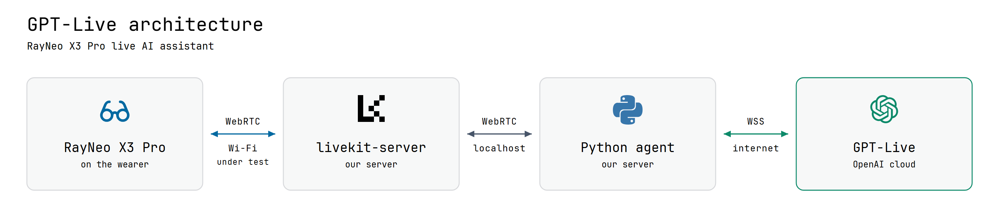
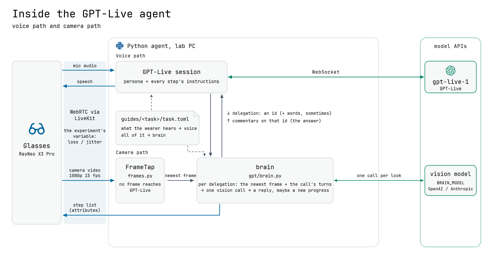

# RayNeo X3 Pro live AI assistant

A voice assistant on RayNeo X3 Pro AR glasses that guides the wearer through a LEGO build, on LiveKit, with GPT-Live or Gemini Live.

## Overview

The project is a test bed: how does the network between the glasses and the server change a voice-and-vision assistant?

The LEGO build is the workload. The wearer picks one of 13 five-brick builds on the glasses and talks it through with the assistant. The assistant sees through the glasses' camera, says which brick to find and where it goes, checks each brick placed and keeps the step list on the glasses current.

The agent has two architectures: GPT-Live with a separate vision model, and Gemini Live alone.

`docs/TASK.md` has the experiment: the task it is based on (ITU-T P.1321's block building), the choices made for ours, what is measured, and the papers behind them. `docs/TODO.md` is the open list.

## Architecture

There are two machines: the glasses, and a server on the same Wi-Fi network. The glasses talk only to the server; only the server talks to the model APIs (OpenAI, Anthropic, Google).

The glasses run the app in `android/`: it sends the mic and camera to the server, plays the assistant's speech and shows the steps. It holds no model keys.

The server runs three programs:

- **livekit-server**, LiveKit's media server: the glasses and the agent join the same room on it; it checks their join tokens and passes audio and video between them.
- **api** (`backend/api/`): lists the builds, and gives the glasses their join token with the build they picked.
- **agent** (`backend/agent/`): joins the room as the assistant, with that build loaded, and holds the model keys. It runs one of the two architectures below, picked by `AGENT_BACKEND`.

A call starts with the glasses asking the api for the builds; the wearer picks one, the glasses get a join token for it and join the room, and the agent joins too. It ends when the wearer ends it on the glasses.

### GPT-Live and a vision model (`AGENT_BACKEND=openai`, `backend/agent/src/gpt/`)





Two models. GPT-Live (`gpt-live-1`) is the voice: it hears the wearer and speaks, both at once, and decides itself when to talk; it takes audio only, so it cannot see. The brain (`gpt/brain.py`) is the eyes: it sends the camera picture to a vision model (OpenAI or Anthropic) and keeps the build's progress.

1. GPT-Live's prompt holds every step, so it answers by itself whatever the steps or the conversation already answer.
2. What needs eyes, or a brick placed, it hands over to the agent: GPT-Live sends a hand-over (a "delegation") with an id, sometimes with the wearer's words.
3. The brain sends one request to the vision model: the newest camera frame, the call so far, the progress, the wearer's words.
4. The brain's reply goes back to GPT-Live as text attached to that id (a "commentary"), and GPT-Live says it in its own words.
5. When the vision model judges that more or fewer steps are built right, it says so through its one tool, `set_progress`: the step list on the glasses changes and the same commentary tells GPT-Live.

<sub>`python docs/make_diagram.py` and `docs/make_agent_diagram.py` regenerate the two figures.</sub>

### Gemini Live (`AGENT_BACKEND=gemini`, `backend/agent/src/gemini/`)

One model, Gemini Live (`GEMINI_MODEL`: `gemini-3.8-live`, or `gemini-3.8-live-extended-thinking` reasoning in the background at `GEMINI_THINKING_LEVEL`), hears, sees and speaks. Its prompt (`gemini/prompts.py`) holds the manner, the task (the plate, the direction words, every step's brick and place, from `src/prompts.py`) and the rules for giving steps, checking the plate and talking.

1. Camera frames go to the model inline with the audio, one a second (`GEMINI_VIDEO_FPS`), each cropped to the bottom square of the frame, the table in front of the wearer, scaled to `GEMINI_SIDE` px (`gemini/sampler.py`, the crop in `src/frames.py`). The model spends `GEMINI_MEDIA_RESOLUTION` tokens on each: 70 at the API default and at LOW or MEDIUM, 280 at HIGH, the most the Live API allows; the lab runs HIGH, since at 70 the model cannot count studs. Every frame stays in the model's context for the rest of the call, so the rate and the resolution set the cost. A sliding window drops the oldest turns past `GEMINI_CONTEXT_TRIGGER_TOKENS`; it is set above what a trial uses, and configured only because Google ends an audio-and-video session at two minutes without it.
2. The model judges the plate from the frames it has and talks to the wearer directly.
3. When it judges that more or fewer steps are built right, it says so through its one tool, `set_progress` (`gemini/tools.py`): the step list on the glasses follows it.

Gemini's own turn detection decides when the wearer has finished. The wearer's audio is transcribed for the log in `GEMINI_TRANSCRIPT_LANGUAGE`; the model's own language is set by the prompt. Each frame shown to the model is saved into the call record (see Logs), so a run can be judged from what the model saw.

## Running

You need a Linux server with Docker on the same Wi-Fi as the glasses, and a Windows PC with adb to drive the glasses. Run every command below on the Windows PC, from the repo root.

### Setting up a new server or new glasses

Clone the repo on the server and generate its config (`lab`: a private LAN, no TLS, `AUTH_MODE=dev`):

```shell
ssh <server> 'cd <repo> && deploy/setup.sh lab'
```

Paste the API keys into `backend/.env` on the server, and add the server's ssh alias and repo path to `SERVERS` in `deploy/backend.py`.

Build the app and install it on the glasses:

```powershell
.\deploy\glasses.ps1 -Ip <server LAN IP> -Install
```

### Running a session

Start the backend on a server (`lab` or `home`) with an architecture (`openai` or `gemini`):

```shell
python deploy/backend.py lab openai
```

Launch the app on the glasses. Swipe to pick a build, tap to call, double tap to end.

```powershell
.\deploy\glasses.ps1 -Ip <server LAN IP>
```

Follow the call live:

```shell
ssh <server> 'cd <repo>/backend && docker compose logs -f --no-log-prefix agent | python3 ../deploy/watch.py'
```

After the call, copy its record into `logs/` and write `report.html`:

```shell
python deploy/pull_run.py
```

Stop the backend:

```shell
python deploy/backend.py lab down
```

### Scripts

`deploy/` holds the scripts. `setup.sh` and `watch.py` run on the server; the rest run on the Windows PC, from the repo root. Each script's header says more. `livekit.lab.yaml` is the livekit-server config that `setup.sh` starts from.

| script | what it does | usage |
|---|---|---|
| `backend.py` | starts the backend on a server with one architecture, or stops it | `python deploy/backend.py {lab\|home} {openai\|gemini\|down}` |
| `setup.sh` | writes a new server's config: a livekit key pair, `livekit.yaml`, `backend/.env`; keeps any of them that already exists | `deploy/setup.sh lab` |
| `watch.py` | prints the call as it happens, from the agent's log: what each side said, the progress, the timings, the warnings | `docker compose logs -f --no-log-prefix agent \| python3 ../deploy/watch.py [-v]`; `-v` also shows the lines it drops |
| `pull_run.py` | copies a call's record from the lab PC into `logs/` and runs `report.py` on it | `python deploy/pull_run.py [<call>]`; the newest call without an argument |
| `report.py` | writes a call's record as one web page, `report.html` in the record's directory | `python deploy/report.py logs/<call>` |
| `glasses.ps1` | builds, installs, launches or stops the app on the glasses | `.\deploy\glasses.ps1 -Ip <server LAN IP> [-Install] [-Task <build>] [-Stop] [-RestoreSleep]` |

## Logs

The agent writes one JSON line per event (`docker compose logs agent`; `deploy/watch.py` shows the call out of it). Each line's message starts with a prefix that says what it is. The first five prefixes appear on both architectures; the rest say which one writes them.

| prefix | the line says |
|---|---|
| `experiment:` | every setting of the run, with `backend=openai` or `gemini` |
| `user:` / `assistant:` | what one side said, written when its turn ends; on the Gemini path the wearer's line is Gemini's transcription of the audio, in `GEMINI_TRANSCRIPT_LANGUAGE` |
| `step`, `build` | a step was done or reopened, the build was finished |
| `camera:`, `link:` | the first frame arrived; the glasses joined, left, or changed link quality |
| `usage:` | the speech model's usage so far, about once a minute; at the end, the session's total and how many camera frames arrived |
| `live:` | GPT-Live: who is speaking; `live: sent` is every event sent to GPT-Live except mic audio, `live: event` is one of GPT-Live's own (a delegation, a receipt, an error). Gemini: the model started or stopped speaking |
| `delegation:` | GPT-Live: it handed a request over, with the wearer's words |
| `brain:` | GPT-Live: one request to the vision model: the frame, the timings, the tokens, the reply, and one line per tool call |
| `voice:` | GPT-Live: it started saying an answer, and how long after the hand-over |
| `gpt-live:` | GPT-Live: the session started or closed, and the seconds billed |
| `model:` | Gemini: one reply's time to first audio, generation length and tokens, the image tokens spelled out (zero means no video is reaching the model) |
| `tool:` | Gemini: it called `set_progress`, and what came of it |

Each call also leaves a record in `backend/runs/<UTC start>-<room>/`: `events.jsonl` (every event with all its fields), the prompts as sent, and the photos: on the GPT path every photo sent to the brain, on the Gemini path every frame shown to the model. `python deploy/pull_run.py [<call>]` copies the newest (or that) record into `logs/`, saves the glasses' `rayneo-link` and `rayneo-speech` lines as `glasses.log` when the glasses are on adb, and writes `report.html` (timeline, waits, what went wrong, each look with its photo and the input as sent; for a Gemini call the frames shown and each `set_progress` with the newest frame before it). The container writes records as root; delete them with `docker run --rm -v "$PWD/runs:/r" backend-agent sh -c "rm -rf /r/2026*"` in `backend/`.

**Never set the root logger to `DEBUG` in code** (`logging.basicConfig(level=logging.DEBUG)` and the like): the `websockets` logger then prints request headers, API keys included. `--log-level debug` on the agent CLI sets the root logger to `DEBUG` too, but holds `websockets.client` at `WARN`. If a key reached a log, rotate it.

## Code

```
backend/
  docker-compose.yml    livekit-server + api + agent
  .env.example          copy to .env; one file for all three
  api/src/              server.py (/getToken, /tasks), auth.py (AUTH_MODE)
  agent/src/agent.py    entrypoint, AGENT_BACKEND picks gpt/ or gemini/
  agent/src/gpt/        GPT-Live and a vision model: agent, config, prompts, brain
  agent/src/gemini/     Gemini Live: agent, config, prompts, tools, sampler
  agent/src/guide.py    task file loader, the build's progress, publishing it to the glasses
  agent/src/prompts.py  the task block both architectures put in their prompts
  agent/src/env.py      what both read from .env
  agent/src/frames.py   the bottom-square crop both paths show their model; FrameTap keeps the newest frame (GPT path)
  agent/src/runlog.py   one record per call (RUN_DIR)
  agent/guides/         the builds the glasses pick from, one task.toml each
android/                the glasses app
tasks/                  the task sheet (sheet.html) and its bricks
deploy/                 setup.sh, backend.py, livekit.lab.yaml, glasses.ps1, watch.py, pull_run.py, report.py
docs/                   TASK.md (the experiment task), TODO.md, notes-gpt-live-official.md,
                        research/, the figures and their scripts
logs/                   records pulled from the lab (not in git)
```

**backend/agent/src/gpt/**: `prompts.py` builds both prompts, the voice's and the brain's, around the shared task block; `brain.py` answers each hand-over (its docstring has the details: the frame's crop, timeouts, a newer hand-over cancelling an older one); `agent.py` wires the session, the brain and the logs.

**backend/agent/src/gemini/**: `prompts.py` builds the prompt around the shared task block; `tools.py` is `set_progress`; `sampler.py` picks which frames the model gets and saves each to the record; `config.py` reads the settings and makes the model; `agent.py` wires the session and the logs.

**Task file** (`backend/agent/guides/<task>/task.toml`): each step has a name for the list on the glasses, the brick, where it goes against the bricks before it, and the cells it covers as drawn on the sheet (used to draw the sheet, never sent to a model). Each file's `number` is its task on `tasks/sheet.html`.

**android/**: the panel is 640x480 per eye, reported as one 1280x480 display at density 160, so every screen draws its content twice through `ui/Eyes.kt`:

- State lives above `Eyes`; a `remember` inside runs once per eye and drifts.
- `Eyes` keeps a 24 dp black margin, because the optics distort at the edges. No window insets at the root: they would span all 1280 px.
- The display is additive: black emits nothing, so the background is black, no light theme.
- Check layouts with `adb shell uiautomator dump`; `screencap` is post-correction and misreports.

The camera sensor is mounted sideways: frames arrive as 1080x1920 portrait, fixed focus. The app sends one 1920x1080 layer, 15 fps, H264 on the hardware encoder at 4 Mbps (`VoiceAssistantViewModel.kt`), through libwebrtc's `HardwareVideoEncoderFactory` directly: the SDK's simulcast wrapper crop-scales this sensor's frames, and VP8 is software here and blurry. `LinkStatsLog.kt` logs the link as WebRTC measures it on the glasses every 5 s under `rayneo-link`: the encoder's size, frame rate and bitrate and what limits it, the round trip and loss the SFU reports back for video and microphone, and for the agent's voice the loss, jitter, jitter-buffer hold and concealed samples. `SpeechEdgeLog.kt` logs under `rayneo-speech` the wall-clock moment the microphone goes quiet and the moment the agent's voice arrives, the glasses' side of a turn's wait. The "Reconnecting" banner reads the SDK engine's own state (`EngineState.kt`), since the public room state stays "connected" through the soft reconnect a Wi-Fi drop triggers.

## Reference

**LiveKit docs** (also searchable through the livekit-docs MCP server)
- [GPT-Live plugin](https://docs.livekit.io/agents/models/realtime/plugins/gpt-live/): delegation modes, the three context channels, starting speech, turns and transcripts
- [Video](https://docs.livekit.io/agents/multimodality/vision/video/), [Agent sessions](https://docs.livekit.io/agents/logic/sessions/): frame sampling, live video input, `video_sampler`, idle users
- [Gemini Live plugin](https://docs.livekit.io/agents/models/realtime/plugins/gemini/), [Gemini vision recipe](https://docs.livekit.io/reference/recipes/gemini_live_vision/): video input and the proactivity option on the Gemini side
- [Subagent delegation](https://docs.livekit.io/agents/logic/patterns/subagent-delegation/): a fast voice model with a slower reasoning model behind it
- [Agent dispatch](https://docs.livekit.io/agents/server/agent-dispatch/), [Token endpoint spec](https://docs.livekit.io/frontends/build/authentication/endpoint/), [Running LiveKit locally](https://docs.livekit.io/transport/self-hosting/local/)

**LiveKit code** ([livekit/agents](https://github.com/livekit/agents))
- [examples/voice_agents/gpt-live](https://github.com/livekit/agents/tree/main/examples/voice_agents/gpt-live): the client-delegation example this agent is built on, and its README on append receipts
- `livekit-plugins-openai/.../realtime/gpt_live_model.py` (also in `backend/agent/.venv`): how the appends, `generate_reply`, `pending_transcript` and the turn split are implemented

**OpenAI**
- Guides: [live](https://developers.openai.com/api/docs/guides/live), [live-conversations](https://developers.openai.com/api/docs/guides/live-conversations), [live-delegation](https://developers.openai.com/api/docs/guides/live-delegation), [live-prompting](https://developers.openai.com/api/docs/guides/live-prompting), [decisions-voice](https://developers.openai.com/api/docs/guides/decisions-voice), [live-partner-integrations](https://developers.openai.com/api/docs/guides/live-partner-integrations), [WebRTC quickstart](https://developers.openai.com/api/docs/guides/voice-webrtc?api=live): sessions, append timing, compaction, delegation and images, how to lay out the prompt; `developers.openai.com/api/docs/llms.txt` indexes them
- [Voice agent evaluation](https://developers.openai.com/cookbook/examples/audio/voice_agent_evaluation) and its harness ([duplex_voice_agent_evaluation](https://github.com/openai/openai-cookbook/tree/main/examples/audio/duplex_voice_agent_evaluation)): testing a GPT-Live agent without people, telling speech from silence on the audio
- [Community thread on gpt-live-1](https://community.openai.com/t/important-feedback-improvements-for-gpt-live-1-api/1402227): field reports on appended instructions and commentary
- [Microsoft Foundry event reference](https://learn.microsoft.com/azure/foundry/openai/gpt-live-reference): every client and server event with its fields

**Pipecat** (GPT-Live with a second model of its own)
- [OpenAI Live service](https://docs.pipecat.ai/api-reference/server/services/s2s/openai-live) and [examples/realtime](https://github.com/pipecat-ai/pipecat/tree/main/examples/realtime) (`realtime-openai-live-client-delegation*.py`, `-responses-delegation.py`)
- `src/pipecat/services/openai/live/llm.py`, `src/pipecat/workers/llm/backend_llm_worker.py`: how the backend's context is kept across hand-overs, spoken vs silent results, overlapping hand-overs

**Google** (Gemini Live)
- [Live guide](https://ai.google.dev/gemini-api/docs/live-guide), [Live tools](https://ai.google.dev/gemini-api/docs/live-tools), [Gemini 3.8 Live](https://ai.google.dev/gemini-api/docs/models/gemini-3.8-live): proactive audio, video input, async function scheduling, model differences
- [Cookbook quickstarts](https://github.com/google-gemini/cookbook/tree/main/quickstarts) (`Get_started_LiveAPI.py`, `Get_started_LiveAPI_tools.ipynb`, `Get_started_Live_Thinking.ipynb`): camera streaming, tool scheduling, background reasoning

**Twilio**: [GPT-Live resources](https://www.twilio.com/en-us/blog/developers/twilio-openai-gpt-live-1-api-resources), phone-call samples, audio only

**The glasses and this project's origins**
- [RayNeo dev docs](https://rayneo-en.gitbook.io/rayneo-devdoc/x-series/android-sdk)
- [agent-starter-android](https://github.com/livekit-examples/agent-starter-android), the app's origin (MIT, `android/LICENSE`)
- [Earlier prototype](https://github.com/Lambozhuang/rayneo-x3-pro-gemini-live), glasses straight to Gemini Live without LiveKit
