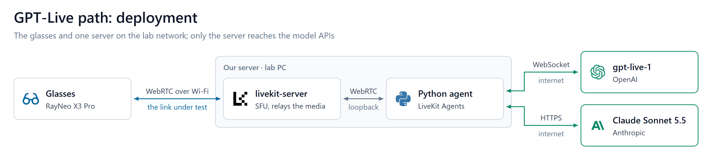

# RayNeo X3 Pro live AI assistant

A voice assistant on RayNeo X3 Pro AR glasses, on LiveKit: GPT-Live or OpenAI Realtime guides the wearer through a LEGO build, and Gemini Live answers whatever the wearer asks about what the camera shows.

## Overview

The project is a test bed: how does the network between the glasses and the server change a voice-and-vision assistant?

The LEGO build is the workload of the GPT and Realtime paths. The wearer picks one of 13 five-brick builds on the glasses and talks it through with the assistant. The assistant sees through the glasses' camera, says which brick to find and where it goes, checks each brick placed and keeps the step list on the glasses current.

The agent has three architectures: GPT-Live with a separate vision model, which runs the LEGO build; OpenAI Realtime alone, which sees the camera itself and runs the LEGO build, as a proof of concept; and Gemini Live alone, which runs no task: it is a general voice assistant that sees through the camera. The Gemini path dropped the LEGO build after the 2026-10-13 lab runs showed it cannot count studs at the 280 tokens the Live API gives a frame.

`docs/TASK.md` has the experiment: the task it is based on (ITU-T P.1321's block building), the choices made for ours, what is measured, and the papers behind them. `docs/TODO.md` is the open list.

## Architecture

There are two machines: the glasses, and a server on the same Wi-Fi network. The glasses talk only to the server; only the server talks to the model APIs (OpenAI, Anthropic, Google).

The glasses run the app in `android/`: it sends the mic and camera to the server, plays the assistant's speech and shows the steps. It holds no model keys.

The server runs three programs:

- **livekit-server**, LiveKit's media server: the glasses and the agent join the same room on it; it checks their join tokens and passes audio and video between them.
- **api** (`backend/api/`): lists the builds, and gives the glasses their join token with the build they picked.
- **agent** (`backend/agent/`): joins the room as the assistant, with that build loaded on the GPT and Realtime paths, and holds the model keys. It runs one of the three architectures below, picked by `AGENT_BACKEND`.

A call starts with the glasses asking the api for the builds; the wearer picks one, the glasses get a join token for it and join the room, and the agent joins too. It ends when the wearer ends it on the glasses.

### GPT-Live and a vision model (`AGENT_BACKEND=openai`, `backend/agent/src/gpt/`)




Two models. GPT-Live (`gpt-live-1`) is the voice: it hears the wearer and speaks, both at once, and decides itself when to talk; it takes audio only, so it cannot see. The brain (`gpt/brain.py`) is the eyes: it sends the camera picture to a vision model (OpenAI or Anthropic), by itself every few seconds and whenever GPT-Live asks, and keeps the build's progress.

1. GPT-Live's prompt holds every step, so it answers by itself whatever the steps or the conversation already answer.
2. What needs eyes, or a brick placed, it hands over to the agent: GPT-Live sends a hand-over (a "delegation") with an id, sometimes with the wearer's words.
3. The brain sends one request to the vision model: the newest camera frame (bottom square at `BRAIN_SIDE`, thinking at `BRAIN_EFFORT`), the call so far, the progress, the wearer's words.
4. The brain's reply goes back to GPT-Live as text attached to that id (a "commentary"), and GPT-Live says it in its own words.
5. When the vision model judges that more or fewer steps are built right, it says so through its tool `set_progress`: the step list on the glasses changes and the same commentary tells GPT-Live.
6. While no hand-over runs, the brain also looks by itself, one look after the other, at most one every `BRAIN_WATCH_EVERY` seconds, on the newest frame at `BRAIN_WATCH_SIDE` without thinking. Nobody asked, so the vision model decides what to do: `note` writes down what may matter later and passes it to GPT-Live silently (a "thinking"), unless it is about what the photo does not let the model tell, `say` has GPT-Live tell the wearer something now (a commentary on no hand-over) once the next look calls `say` too, since GPT-Live cannot take back what it was told, `set_progress` moves the build and tells GPT-Live in a commentary on no hand-over, and no tool at all leaves no trace. A hand-over cancels the look running and the watch goes on after it.

The call so far, in every request, is one line per entry with its time into the call: what the wearer and GPT-Live said, and what the brain itself noted, had GPT-Live say, or answered. No photo is kept from one request to the next.

<sub>`python docs/make_gpt_live_overview.py` and `docs/make_gpt_live_agent.py` regenerate the two figures.</sub>

### OpenAI Realtime (`AGENT_BACKEND=realtime`, `backend/agent/src/realtime/`)

One model, OpenAI Realtime (`REALTIME_MODEL`, `gpt-realtime-2.1`), hears, sees, speaks and keeps the build's progress. It is a proof of concept, there to find out how well the model alone runs the LEGO build. Its prompt (`realtime/prompts.py`) holds every step, and its one tool, `set_progress`, moves the step list on the glasses (`realtime/tools.py`). It reasons at `REALTIME_REASONING_EFFORT` (minimal to xhigh, required). Turn detection and input transcription are the plugin's defaults; the voice is marin.

1. Camera frames go into the model's conversation as image messages: one a second while the wearer speaks (`REALTIME_SPEAKING_FPS`), one every ~3 s otherwise (`REALTIME_SILENT_FPS`, 0.3), the rule of LiveKit's own video sampler. Each is the bottom square of the frame, the table in front of the wearer, scaled to `REALTIME_SIDE` px, 1080 by default (`realtime/sampler.py`, the crop in `src/frames.py`). Every frame stays in the model's context and is read again on every turn, so the rates set the cost.
2. The model answers the wearer from what it hears and the frames it has; when it judges that more or fewer steps are built right, it calls `set_progress`, and speaks its verdict after the call returns.

The API's turn detection decides when the wearer has finished, and sets the wearer's state that picks the frame rate. Each frame shown to the model is saved into the call record (see Logs), so a run can be judged from what the model saw.

### Gemini Live (`AGENT_BACKEND=gemini`, `backend/agent/src/gemini/`)

One model, Gemini Live (`GEMINI_MODEL`: `gemini-3.8-live`, or `gemini-3.8-live-extended-thinking` reasoning in the background at `GEMINI_THINKING_LEVEL`), hears, sees and speaks. It has no task and no tools: its prompt (`gemini/prompts.py`) is the one the glasses-only prototype (rayneo-x3-pro-gemini-live) sends, word for word, and pins the reply language to English. The session is set up as the prototype sets up its own, apart from the camera frames and the turn detection: the voice Kore, `MEDIA_RESOLUTION_LOW`, the API's own sliding window over the context, and no greeting, so the wearer speaks first. The agent ignores the build the wearer picked, so the glasses show no step list.

1. Camera frames go to the model inline with the audio, one a second (`GEMINI_VIDEO_FPS`, the most the Live API takes), each cropped to the middle square of the frame and scaled to `GEMINI_SIDE` x `GEMINI_SIDE` px, 768 by default as Google recommends (`gemini/sampler.py`, the crop in `src/frames.py`). The model spends `GEMINI_MEDIA_RESOLUTION` tokens on each: 70 at the API default and at LOW or MEDIUM, 280 at HIGH, the most the Live API allows; the lab runs LOW, as the prototype does. Every frame stays in the model's context until the sliding window drops it, so the rate and the resolution set the cost. The window runs at the API's own trigger and target, and is configured because Google ends an audio-and-video session at two minutes without it.
2. The model answers the wearer from what it hears and the frames it has.

Gemini's own turn detection decides when the wearer has finished. Both sides are transcribed for the log in US English; the model always answers in English, whatever `AGENT_LANGUAGE` says. Each frame shown to the model is saved into the call record (see Logs), so a run can be judged from what the model saw.

## Running

You need a Linux server with Docker on the same Wi-Fi as the glasses, and a Windows PC with adb to drive the glasses. Run every command below on the Windows PC, from the repo root.

### Setting up a new server or new glasses

Clone the repo on the server and generate its config (`lab`: a private LAN, no TLS, `AUTH_MODE=dev`):

```shell
ssh <server> 'cd <repo> && deploy/setup.sh lab'
```

Paste the API keys into `backend/.env` on the server, and add the server's ssh alias and repo path to `SERVERS` in `deploy/backend.py`.

Build the app and install it on the glasses:

```powershell
.\deploy\glasses.ps1 -Ip <server LAN IP> -Install
```

### Running a session

Start the backend on a server (`lab` or `home`) with an architecture (`openai`, `realtime` or `gemini`):

```shell
python deploy/backend.py lab openai
```

Launch the app on the glasses. Swipe to pick a build, tap to call, double tap to end.

```powershell
.\deploy\glasses.ps1 -Ip <server LAN IP>
```

Follow the call live:

```shell
ssh <server> 'cd <repo>/backend && docker compose logs -f --no-log-prefix agent | python3 ../deploy/watch.py'
```

After the call, copy its record into `logs/` and write `report.html`:

```shell
python deploy/pull_run.py
```

Stop the backend:

```shell
python deploy/backend.py lab down
```

### Scripts

`deploy/` holds the scripts. `setup.sh` and `watch.py` run on the server; the rest run on the Windows PC, from the repo root. Each script's header says more. `livekit.lab.yaml` is the livekit-server config that `setup.sh` starts from.

| script | what it does | usage |
|---|---|---|
| `backend.py` | starts the backend on a server with one architecture, or stops it | `python deploy/backend.py {lab\|home} {openai\|realtime\|gemini\|down}` |
| `setup.sh` | writes a new server's config: a livekit key pair, `livekit.yaml`, `backend/.env`; keeps any of them that already exists | `deploy/setup.sh lab` |
| `watch.py` | prints the call as it happens, from the agent's log: what each side said, the progress, the timings, the warnings | `docker compose logs -f --no-log-prefix agent \| python3 ../deploy/watch.py [-v]`; `-v` also shows the lines it drops |
| `pull_run.py` | copies a call's record from the lab PC into `logs/` and runs `report.py` on it | `python deploy/pull_run.py [<call>]`; the newest call without an argument |
| `report.py` | writes a call's record as one web page, `report.html` in the record's directory | `python deploy/report.py logs/<call>` |
| `glasses.ps1` | builds, installs, launches or stops the app on the glasses | `.\deploy\glasses.ps1 -Ip <server LAN IP> [-Install] [-Task <build>] [-Record] [-Stop] [-RestoreSleep]` |

## Media and network settings

The glasses talk WebRTC to livekit-server over Wi-Fi and the lab LAN; the server forwards the RTP unchanged to the agent on the same machine; the agent reaches the models over the internet. Everything not listed is a default.

| | glasses | livekit-server | agent |
|---|---|---|---|
| stack | LiveKit Android SDK 2.28 on libwebrtc | livekit-server 1.13 (Go, Pion) | livekit-agents 1.8, libwebrtc through the Rust SDK |
| transport | Wi-Fi to the server: UDP 50000-60000, TCP 7881 fallback, signalling ws://7880, no TURN, no TLS | same, bound to the LAN address (`deploy/livekit.lab.yaml`) | loopback to the server; WebSocket to GPT-Live, HTTPS to the brain's model; or WebSocket to OpenAI Realtime or Gemini |
| video | sends one layer 1920x1080 at 15 fps, H264 hardware encoder, 4 Mbps cap, simulcast off, `MAINTAIN_RESOLUTION` (`VoiceAssistantViewModel.kt`) | forwards | receives and decodes; keeps the newest frame for the brain (`frames.py`), or sends Gemini one a second (`gemini/sampler.py`), or sends OpenAI Realtime one a second while the wearer speaks and one every ~3 s otherwise (`realtime/sampler.py`) |
| audio | sends Opus 48 kHz with AEC/NS/AGC, 48 kbps cap, DTX, wrapped in RED (the SDK's `AudioTrackPublishDefaults`); Opus in-band FEC is negotiated (`useinbandfec=1`), whether the encoder puts it in is not known; plays the agent's Opus, which arrives in RED | forwards | decodes the glasses' Opus for the speech model (GPT-Live, or Gemini at 16 kHz); sends the model's voice as Opus with DTX, wrapped in RED (the Rust SDK's `TrackPublishOptions` default, which room_io keeps) |
| loss repair | NACK and PLI (libwebrtc default); RED on the audio it sends | NACK and PLI toward both ends, no FEC (default) | NACK and PLI (default); RED on the audio it sends |
| receiver side | jitter buffer about 150 ms, Opus PLC | none, no decoding | jitter buffer, Opus PLC |
| congestion control | GCC with transport-wide feedback for what it sends | its own estimator for what it sends down | not on an impaired link |
| what it logs | every 5 s: RTT, loss, encoder size/fps/bitrate/limit, NACK/PLI, jitter-buffer hold, concealed samples (`LinkStatsLog.kt`); speech edges (`SpeechEdgeLog.kt`) | connection quality score only | the call's record (`runlog.py`) |

## Logs

The agent writes one JSON line per event (`docker compose logs agent`; `deploy/watch.py` shows the call out of it). Each line's message starts with a prefix that says what it is. The first five prefixes appear on every architecture; the rest say which one writes them.

| prefix | the line says |
|---|---|
| `experiment:` | every setting of the run, with `backend=openai`, `realtime` or `gemini` |
| `user:` / `assistant:` | what one side said, written when its turn ends; on the Gemini path both lines are Gemini's transcriptions of the audio, in US English |
| `step`, `build` | GPT-Live and Realtime: a step was done or reopened, the build was finished |
| `camera:`, `link:` | the first frame arrived; the glasses joined, left, or changed link quality |
| `usage:` | the speech model's usage so far, about once a minute; at the end, the session's total and how many camera frames arrived |
| `live:` | GPT-Live: who is speaking; `live: sent` is every event sent to GPT-Live except mic audio, `live: event` is one of GPT-Live's own (a delegation, a receipt, an error). Realtime: who is speaking, the wearer's state from the API's turn detection. Gemini: the model started or stopped speaking |
| `delegation:` | GPT-Live: it handed a request over, with the wearer's words |
| `brain:` | GPT-Live: one request to the vision model, a delegation or a watch look: the frame, the timings, the tokens, the reply, and one line per tool call |
| `watch:` | GPT-Live: a watch look failed, or was dropped for a hand-over |
| `voice:` | GPT-Live: it started saying an answer, and how long after the hand-over |
| `gpt-live:` | GPT-Live: the session started or closed, and the seconds billed |
| `tool:` | Realtime: one `set_progress` call and what came of it: moved, unchanged or ignored |
| `model:` | Gemini and Realtime: one reply's time to first audio, generation length and tokens, the image tokens spelled out (zero means no video is reaching the model) |

Each call also leaves a record in `backend/runs/<UTC start>-<room>/`: `events.jsonl` (every event with all its fields), the prompts as sent, and the photos: on the GPT path every photo sent to the brain, on the Realtime and Gemini paths every frame shown to the model. `python deploy/pull_run.py [<call>]` copies the newest (or that) record into `logs/`, saves the glasses' `rayneo-call`, `rayneo-link`, `rayneo-speech` and `rayneo-record` lines as `glasses.log` (`rayneo-call` bounds each call with its room name) and the glasses' clock offset against the server's as `clock.json` when the glasses are on adb, pulls the glasses' recording of the call into `recording/` when there is one, and writes `report.html` (timeline, waits, what went wrong, each look with its photo and the input as sent, and on the GPT path each watch look that noted, said, moved the build or failed; for a Realtime or Gemini call the frames shown to the model and the `set_progress` calls). With `glasses.log` and `clock.json` beside the record the timeline also shows the wearer's voice at the microphone and the agent's voice as decoded on the glasses, and a GPT-Live call gets one stacked bar per hand-over splitting the wait from the wearer's last word to the answer in their ear into network up with GPT-Live's turn end, the brain's preparation and model, GPT-Live taking up the answer, and network down. The container writes records as root; delete them with `docker run --rm -v "$PWD/runs:/r" backend-agent sh -c "rm -rf /r/2026*"` in `backend/`.

**Never set the root logger to `DEBUG` in code** (`logging.basicConfig(level=logging.DEBUG)` and the like): the `websockets` logger then prints request headers, API keys included. `--log-level debug` on the agent CLI sets the root logger to `DEBUG` too, but holds `websockets.client` at `WARN`. If a key reached a log, rotate it.

## Code

```
backend/
  docker-compose.yml    livekit-server + api + agent
  .env.example          copy to .env; one file for all three
  api/src/              server.py (/getToken, /tasks), auth.py (AUTH_MODE)
  agent/src/agent.py    entrypoint, AGENT_BACKEND picks gpt/ or gemini/
  agent/src/gpt/        GPT-Live and a vision model: agent, config, prompts, brain
  agent/src/realtime/   OpenAI Realtime: agent, config, prompts, sampler, tools
  agent/src/gemini/     Gemini Live: agent, config, prompts, sampler
  agent/src/guide.py    task file loader, the build's progress, publishing it to the glasses
  agent/src/prompts.py  the task block the GPT and Realtime paths put in their prompts
  agent/src/env.py      what both read from .env
  agent/src/frames.py   the crop each path shows its model; FrameTap keeps the newest frame (GPT path)
  agent/src/runlog.py   one record per call (RUN_DIR)
  agent/guides/         the builds the glasses pick from, one task.toml each
android/                the glasses app
tasks/                  the task sheet (sheet.html) and its bricks
deploy/                 setup.sh, backend.py, livekit.lab.yaml, glasses.ps1, watch.py, pull_run.py, report.py
docs/                   TASK.md (the experiment task), TODO.md, notes-gpt-live-official.md,
                        research/, the figures and their scripts
logs/                   records pulled from the lab (not in git)
```

**backend/agent/src/gpt/**: `prompts.py` builds both prompts, the voice's and the brain's, around the shared task block; `brain.py` looks by itself between hand-overs and answers each hand-over (its docstring has the details: the frame's crop, timeouts, a newer hand-over cancelling an older one and the look running, a say held for the next look); `agent.py` wires the session, the brain and the logs.

**backend/agent/src/realtime/**: `prompts.py` is the prompt; `tools.py` is `set_progress`; `sampler.py` picks which frames the model gets and saves each to the record; `config.py` reads the settings and makes the model; `agent.py` wires the session, the build and the logs.

**backend/agent/src/gemini/**: `prompts.py` is the prompt; `sampler.py` picks which frames the model gets and saves each to the record; `config.py` reads the settings and makes the model; `agent.py` wires the session and the logs.

**Task file** (`backend/agent/guides/<task>/task.toml`): each step has a name for the list on the glasses, the brick, where it goes against the bricks before it, and the cells it covers as drawn on the sheet (used to draw the sheet, never sent to a model). Each file's `number` is its task on `tasks/sheet.html`.

**android/**: the panel is 640x480 per eye, reported as one 1280x480 display at density 160, so every screen draws its content twice through `ui/Eyes.kt`:

- State lives above `Eyes`; a `remember` inside runs once per eye and drifts.
- `Eyes` keeps a 24 dp black margin, because the optics distort at the edges. No window insets at the root: they would span all 1280 px.
- The display is additive: black emits nothing, so the background is black, no light theme.
- Check layouts with `adb shell uiautomator dump`; `screencap` is post-correction and misreports.

The camera sensor is mounted sideways: frames arrive as 1080x1920 portrait, fixed focus. The app sends one 1920x1080 layer, 15 fps, H264 on the hardware encoder at 4 Mbps (`VoiceAssistantViewModel.kt`), through libwebrtc's `HardwareVideoEncoderFactory` directly: the SDK's simulcast wrapper crop-scales this sensor's frames, and VP8 is software here and blurry. `LinkStatsLog.kt` logs the link as WebRTC measures it on the glasses every 5 s under `rayneo-link`: the encoder's size, frame rate and bitrate and what limits it, the round trip and loss the SFU reports back for video and microphone, and for the agent's voice the loss, jitter, jitter-buffer hold and concealed samples. `SpeechEdgeLog.kt` logs under `rayneo-speech` the wall-clock moment the microphone goes quiet and the moment the agent's voice arrives, the glasses' side of a turn's wait. The status band's "Thinking" comes from the agent's `rayneo.brain.looking` attribute, set while a hand-over to the vision model runs, since the speech model's own state stays "listening" through one (`Phase.kt`, `gpt/brain.py`). The status band's "Reconnecting" reads the SDK engine's own state (`EngineState.kt`), since the public room state stays "connected" through the soft reconnect a Wi-Fi drop triggers.

A launch with `glasses.ps1 -Record` (`--ez record true`) records every call of that launch on the glasses as material for offline work, such as re-encoding at other codecs, sizes and bitrates or sending it through an impaired link (`Recording.kt`); any launch without it turns recording off. The camera then captures at 30 fps, and a second hardware encoder writes it as H.264 in VBR with a 70 Mbps ceiling, 1920x1080 with the rotation in the MP4, while the call's own encoder still sends 15 a second; the frames are exposed for at most 1/30 s instead of 1/15 s, so a recorded call is not a formal run. The microphone and the agent's voice go to WAV as PCM. Every camera frame and every 10 ms of audio gets a line with the glasses' wall clock, which `clock.json` puts on the server's time axis. Files land in the app's external files dir under `recordings/<room>/`, about 0.6 GB for 5 minutes: on the 2026-10-19 desk scene the encoder held QP 20 and used 13 to 19 Mbps (15 a second on average), well under the ceiling; delete them with `adb shell rm -rf /sdcard/Android/data/com.rayneo.x3pro.assistant/files/recordings`. A frame the second encoder cannot take yet is skipped and marked in `video.csv`, so the camera never waits on it.

## Reference

**LiveKit docs** (also searchable through the livekit-docs MCP server)
- [GPT-Live plugin](https://docs.livekit.io/agents/models/realtime/plugins/gpt-live/): delegation modes, the three context channels, starting speech, turns and transcripts
- [Video](https://docs.livekit.io/agents/multimodality/vision/video/), [Agent sessions](https://docs.livekit.io/agents/logic/sessions/): frame sampling, live video input, `video_sampler`, idle users
- [OpenAI Realtime plugin](https://docs.livekit.io/agents/models/realtime/openai/): video input, the default frame rates, turn detection
- [Gemini Live plugin](https://docs.livekit.io/agents/models/realtime/plugins/gemini/), [Gemini vision recipe](https://docs.livekit.io/reference/recipes/gemini_live_vision/): video input and the proactivity option on the Gemini side
- [Subagent delegation](https://docs.livekit.io/agents/logic/patterns/subagent-delegation/): a fast voice model with a slower reasoning model behind it
- [Agent dispatch](https://docs.livekit.io/agents/server/agent-dispatch/), [Token endpoint spec](https://docs.livekit.io/frontends/build/authentication/endpoint/), [Running LiveKit locally](https://docs.livekit.io/transport/self-hosting/local/)

**LiveKit code** ([livekit/agents](https://github.com/livekit/agents))
- [examples/voice_agents/gpt-live](https://github.com/livekit/agents/tree/main/examples/voice_agents/gpt-live): the client-delegation example this agent is built on, and its README on append receipts
- `livekit-plugins-openai/.../realtime/gpt_live_model.py` (also in `backend/agent/.venv`): how the appends, `generate_reply`, `pending_transcript` and the turn split are implemented

**OpenAI**
- Guides: [live](https://developers.openai.com/api/docs/guides/live), [live-conversations](https://developers.openai.com/api/docs/guides/live-conversations), [live-delegation](https://developers.openai.com/api/docs/guides/live-delegation), [live-prompting](https://developers.openai.com/api/docs/guides/live-prompting), [decisions-voice](https://developers.openai.com/api/docs/guides/decisions-voice), [live-partner-integrations](https://developers.openai.com/api/docs/guides/live-partner-integrations), [WebRTC quickstart](https://developers.openai.com/api/docs/guides/voice-webrtc?api=live): sessions, append timing, compaction, delegation and images, how to lay out the prompt; `developers.openai.com/api/docs/llms.txt` indexes them
- [Voice agent evaluation](https://developers.openai.com/cookbook/examples/audio/voice_agent_evaluation) and its harness ([duplex_voice_agent_evaluation](https://github.com/openai/openai-cookbook/tree/main/examples/audio/duplex_voice_agent_evaluation)): testing a GPT-Live agent without people, telling speech from silence on the audio
- [Community thread on gpt-live-1](https://community.openai.com/t/important-feedback-improvements-for-gpt-live-1-api/1402227): field reports on appended instructions and commentary
- [Microsoft Foundry event reference](https://learn.microsoft.com/azure/foundry/openai/gpt-live-reference): every client and server event with its fields

**Pipecat** (GPT-Live with a second model of its own)
- [OpenAI Live service](https://docs.pipecat.ai/api-reference/server/services/s2s/openai-live) and [examples/realtime](https://github.com/pipecat-ai/pipecat/tree/main/examples/realtime) (`realtime-openai-live-client-delegation*.py`, `-responses-delegation.py`)
- `src/pipecat/services/openai/live/llm.py`, `src/pipecat/workers/llm/backend_llm_worker.py`: how the backend's context is kept across hand-overs, spoken vs silent results, overlapping hand-overs

**Google** (Gemini Live)
- [Live guide](https://ai.google.dev/gemini-api/docs/live-guide), [Live tools](https://ai.google.dev/gemini-api/docs/live-tools), [Gemini 3.8 Live](https://ai.google.dev/gemini-api/docs/models/gemini-3.8-live): proactive audio, video input, async function scheduling, model differences
- [Cookbook quickstarts](https://github.com/google-gemini/cookbook/tree/main/quickstarts) (`Get_started_LiveAPI.py`, `Get_started_LiveAPI_tools.ipynb`, `Get_started_Live_Thinking.ipynb`): camera streaming, tool scheduling, background reasoning

**Twilio**: [GPT-Live resources](https://www.twilio.com/en-us/blog/developers/twilio-openai-gpt-live-1-api-resources), phone-call samples, audio only

**The glasses and this project's origins**
- [RayNeo dev docs](https://rayneo-en.gitbook.io/rayneo-devdoc/x-series/android-sdk)
- [agent-starter-android](https://github.com/livekit-examples/agent-starter-android), the app's origin (MIT, `android/LICENSE`)
- [Earlier prototype](https://github.com/Lambozhuang/rayneo-x3-pro-gemini-live), glasses straight to Gemini Live without LiveKit
